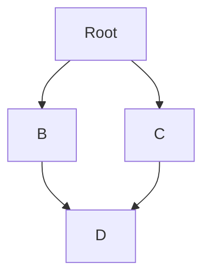

# Inventory traversal review

The source inventory still has no complete result for the actual repository.
Its reflection analysis can revisit a shared type through many paths, even when
those visits add the same method to the answer. The pending decision concerns
how to avoid proven duplicate work while preserving the analysis that prevents
an incomplete inventory from being published as complete.

The approved input boundary remains unchanged. The analyzer inspects retained
Git source and checks whether external code can reach registration functions or
alter registration metadata through accessible values. Ordinary reflection over
those values is part of that analysis. The
[external-effects decision](INVENTORY-EXTERNAL-EFFECTS.md#the-change-thomas-approved)
records its bounded trust contract. Neither traversal proposal adds library
source or treats familiar libraries as harmless.

The last retained test of the actual repository,
`TestAnswerAnswersTheInventory`, reached its unchanged ten-minute limit without
a report. That run followed three approaches: cheaper binding and output
construction, reuse of completed receiver queries, and an ordered method census.
Each reduced work inside a visit, but the complete inventory still failed to
finish. The matching binary and profiles survive outside managed scratch, as
recorded in the [recovery record](plan/post-release/engineering/tooling-one-off-evidence-recovery-2026-11-06.md#inventory-traversal-decision).
This timeout predates later correctness repairs. There is no fresh actual-root
result establishing the current evaluator's completion or correctness.

The CPU profile places most sampled work in the descriptor traversal. It does
not count equivalent visits or prove that avoidable duplication dominates the
actual repository. The model under review is therefore whether making each
visit cheaper is sufficient when the number of visits can multiply.

In [externalreflectiontypes.go](internal/le/repo/inventory/externalreflectiontypes.go),
`externalReflectionWalk.collectNamed` keeps a list of named types on the active
recursive path. This prevents a cycle from continuing indefinitely. It removes
the entry when the call returns, so a later sibling can traverse the completed
subgraph again. The output map retains one entry per method, while
`collectMethods` still traverses its signature on each matching visit.

After the traversal returns from B, it reaches D again through C. Repeating this
shape across levels multiplies paths through a small set of type declarations.
The existing depth-128 guard limits each path's length. It does not prevent
shared subgraphs from being visited through many paths.

A diagnostic overlay observed this behavior without changing the evaluator's
answers. All nine cases passed with race instrumentation. At synthetic depth
12, the results were:

| Observation | Single-child chain | Branching diamond |
|-------------|--------------------|-------------------|
| Collection calls | 29 | 24,575 |
| Distinct structural keys | 29 | 41 |
| Method-signature visits | 1 | 4,096 |

Both returned the same `Touch` method, with no external origins or uncertainty.
Recursive, distinct-generic-binding, and diagnostic-storage-overflow controls
also passed. The [recorded observation](plan/post-release/engineering/tooling-one-off-evidence-recovery-2026-11-06.md#inventory-traversal-decision)
contains the exact test command and retained log identity.

Those structural keys omit generic substitutions, lexical bindings, and active
ancestors. They demonstrate repeated traversal in the synthetic graph, without
proving that those visits are interchangeable. The counts support no speedup
promise. The next measurement must establish how often the current actual-root
analysis repeats contributions that can safely be skipped.

A global “already visited this type” set can lose facts. A different incoming
depth changes whether the depth refusal occurs, and a generic type can expose
different capabilities for different arguments. Traversal also depends on which
methods are visible and whether the starting point is a value or a type
descriptor. Active ancestors matter even without generics:
if D also refers to B, the traversal through B prunes that return edge, while
the traversal through C can enter B. A completed visit under one ancestry does
not establish what another ancestry contributes.

Route A remembers completed contributions within one query and its same output
union. That union only accumulates methods, external origins, and uncertainty.
If an equivalent contribution is already represented there, repeating it adds
nothing. The proposal stores proof of coverage rather than cached answer maps
or borrowed lexical scopes, and every new query retains its own fresh output.

Reuse requires exact incoming depth, substitutions, and traversal flags. It also
requires proof that the old and new ancestor paths prune equivalent work, or
that the contribution is independent of both paths. That proof must include
targets pruned during the original visit. A completed visit alone is
insufficient. Whenever proof is unavailable or the coverage table is full, the
original traversal runs. Route A is the recommended incremental choice only if
measurement shows that its provable subset covers the repeated actual work.

Route B replaces recursive execution with an explicit graph of analysis states
and ordered continuations that record which operation comes next. States retain
the relevant semantic context, including active ancestors. This larger rewrite
makes pending work and completion explicit, which may make broader reuse easier
to prove. It still needs that proof before merging states. Distinct contexts can
multiply, so an explicit graph carries no automatic polynomial-time guarantee.

Either repair must preserve the Git-only trust contract, exact depth boundary,
refusal order, and independently owned outputs. Proof must cover completion
before reuse, different depths and generic arguments, scope ownership, cycles,
ancestor collisions, and capacity fallback. The actual inventory must complete,
its consumers must accept the result, and tests for unsafe capabilities exposed
through type information must still refuse unsafe inventories. Separate
correctness defects and remaining signed
fixture failures remain owed: faster traversal alone cannot establish a correct,
complete inventory.

The review decision remains between A and B. Neither route is implemented or
approved. Actual-root measurement and proof of semantic reuse must precede any
claim about their impact.
