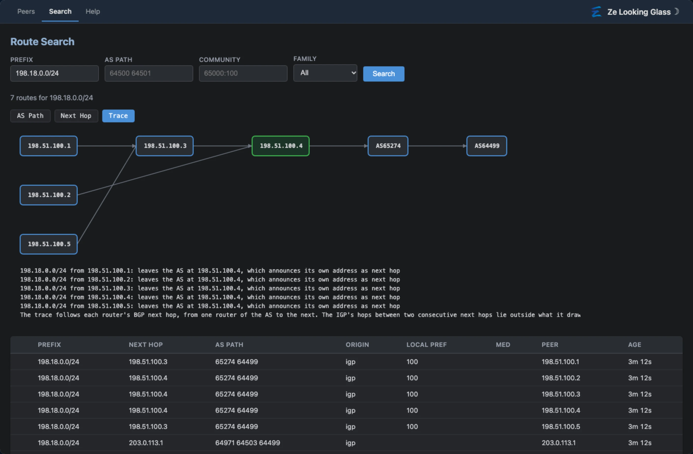
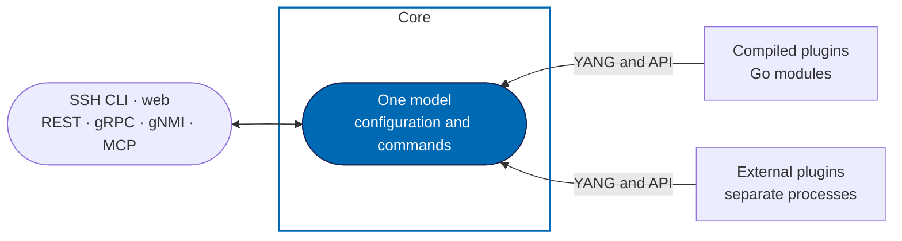

<div align="center">

[](https://ze-software.net/)

# Ze

**A network OS with programmable routing, fully written in Go.**\
**Routing:** BGP, OSPF, IS-IS, BFD, VRRP, LDP, RSVP-TE\
**Network services:** IPsec, L2TP, PPPoE, DHCP, DNS\
All in one binary, with plugins for custom behavior.

[Website](https://ze-software.net/) ·
[Quick start](docs/guide/quickstart.md) ·
[Demonstrations](https://ze-software.net/demos/terminal/) ·
[Development updates](https://ze-software.net/project/changes/) ·
[Discord](https://discord.gg/T8s7CjPDne)

<sub>Self-contained · Extend with plugins · Appliance option · ExaBGP compatible</sub>

[](https://ze-software.net/reference/feature-status/)
[](LICENSE)
[](go.mod)
[](https://ze-software.net/quality/rfc-compliance/)
[](https://discord.gg/T8s7CjPDne)

</div>

<!-- terminal-demo-hero:start -->
<table>
<tr>
<td width="50%"><a href="https://ze-software.net/demos/terminal/#live-bgp-dashboard"></a></td>
<td width="50%"><a href="docs/guide/looking-glass.md"></a></td>
</tr>
<tr>
<td valign="top"><sub><b>Watch Ze at work.</b> The configuration editor and live BGP dashboard in one SSH session.</sub></td>
<td valign="top"><sub><b>Follow a route through the network.</b> Trace mode follows a prefix from each router to the exit, then along the AS path to its origin.</sub></td>
</tr>
</table>

The [site player and transcript](https://ze-software.net/demos/terminal/#live-bgp-dashboard)
provide playback controls and the command sequence for the animation. More
recordings are on the [demonstrations page](https://ze-software.net/demos/terminal/),
and the [looking glass guide](docs/guide/looking-glass.md) explains tracing a
prefix router by router.
<!-- terminal-demo-hero:end -->

Ze brings routing, Linux networking and network services together through a
configuration and plugin engine. You can use it as a programmable BGP controller,
or as a router that runs its own routing protocols and configures its
interfaces and forwarding table.

One YANG-defined configuration is shared by Ze's SSH CLI, web editor and APIs.
Ze can run as a Linux daemon or an immutable appliance, and its Model Context
Protocol (MCP) server lets AI assistants discover and use the daemon's commands.

I wrote [ExaBGP](https://github.com/Exa-Networks/exabgp), and its users are the
people I had in mind while building Ze. The aim is to keep programmable routing
and add control of the device around it, with one configuration for the protocols
and the system they run on.

> [!IMPORTANT]
> **Pre-release.** Ze has not been released yet. Some features are incomplete or
> experimental, and APIs and configuration syntax can change. The
> [feature inventory](https://ze-software.net/reference/feature-status/) records
> their status. A lab is the right place to evaluate Ze before putting it on a
> live network.

## Start here

Each route below ends with Ze running and something to look at.

| To explore | Start with |
|------------|------------|
| A first BGP session | [Quick Start](docs/guide/quickstart.md) |
| A network lab | [netlab and containerlab](docs/guide/netlab.md) |
| Docker | [Docker guide](docs/guide/docker.md) |
| An existing ExaBGP deployment | [Migration guide](docs/exabgp/exabgp-migration.md) |
| A dedicated device or VM | [Appliance guide](docs/guide/appliance.md) |
| Testing Ze with Claude Code or Codex | [Use Ze with an AI agent](docs/guide/ai-agent.md): `ze create agent skill` sets the agent up |

## Why Ze

A controller like ExaBGP, with control of the device it runs on.

<table>
<tr>
<td width="50%" valign="top"><b>Programmable routing.</b><br>Ze keeps ExaBGP's controller model: scripts can receive routing events and inject routes. You can develop plugins in any programming language, or use the native APIs for your own integrations.</td>
<td width="50%" valign="top"><b>Tools for operators.</b><br>The CLI provides contextual completion, configuration comparisons and a live BGP dashboard. A looking glass exposes routing state, and <code>ze doctor</code> reports configuration and runtime problems with commands to address them.</td>
</tr>
<tr>
<td valign="top"><b>A choice of deployment.</b><br>The same configuration model is available in a Linux service, a <a href="docs/guide/docker.md">Docker container</a>, an immutable <a href="docs/guide/appliance.md">appliance</a> or a <a href="docs/guide/netlab.md">containerlab</a> network.</td>
<td valign="top"><b>Tools for AI assistants.</b><br>MCP exposes the running daemon's commands. For local testing, <code>ze create agent skill</code> installs a Ze skill and session-start hook for Claude Code or Codex (Codex asks you to trust the hook once), so an agent can use Ze's own help and tools.</td>
</tr>
</table>

<table>
<tr align="center" valign="top">
<td width="25%"><h2>1</h2><b>binary</b><br><sub>routing protocols and network services</sub></td>
<td width="25%"><h2>1</h2><b>configuration</b><br><sub>YANG-defined, shared by every interface</sub></td>
<td width="25%"><h2>6</h2><b>ways in</b><br><sub>SSH CLI, web, REST, gRPC, gNMI, MCP</sub></td>
<td width="25%"><h2>4</h2><b>ways to run</b><br><sub>Linux, Docker, appliance, containerlab</sub></td>
</tr>
</table>

## What you can do

Features depend on the build and configuration, and most of them are still
experimental: implemented and reachable, but not yet at the level the
[feature inventory](https://ze-software.net/reference/feature-status/)
calls supported. The inventory gives each feature a level (supported,
experimental or stub-backed) and lists what partial implementations still lack.

| Area | What you can do | Guides |
|------|-----------------|--------|
| BGP and programmable routing | Exchange and inject routes, validate origins with RPKI, and maintain IRR prefix filters, with AS-SET discovery through PeeringDB (tested so far only against a stub IRR server). | [BGP](docs/features/bgp-protocol.md), [route injection](docs/guide/route-injection.md), [RPKI](docs/guide/rpki.md), and [IRR filtering](docs/guide/irr-filtering.md) |
| Routing inside a network | Run OSPF, IS-IS, BFD, VRRP, and MPLS with LDP and RSVP-TE, with redistribution and shared routing policy. | [OSPF](docs/guide/ospf.md), [IS-IS](docs/guide/isis.md), [BFD](docs/guide/bfd.md), [VRRP](docs/guide/vrrp.md), [MPLS](docs/guide/mpls.md), [RSVP-TE](docs/guide/rsvp-te.md), [redistribution](docs/guide/redistribution.md), and [routing policy](docs/guide/route-policy.md) |
| Linux networking | Configure interfaces, routes, policy routing, firewall rules, and IPsec. | [Interfaces](docs/features/interfaces.md), [static routes](docs/guide/static-routes.md), [policy routing](docs/guide/policy-routing.md), [firewall](docs/guide/firewall.md), and [IPsec](docs/guide/ipsec.md) |
| Access and network services | Run PPPoE and L2TP subscriber access, DNS forwarding, and DHCP service. | [PPPoE](docs/guide/pppoe.md), [L2TP](docs/guide/l2tp.md), [DNS resolver](docs/guide/dns-resolver.md), and [DHCP](https://ze-software.net/reference/plugins/dhcpserver/) |
| Configuration and operations | Edit configuration and inspect the running system. | [Configuration](docs/guide/configuration.md), [CLI](docs/guide/cli.md), [command reference](docs/guide/command-reference.md), and [operations](docs/guide/operations.md) |
| Automation and visibility | Extend Ze and observe its routing state. | [Plugins](docs/plugin-development/), [MCP](docs/guide/mcp/overview.md), [AI agents](docs/guide/ai-agent.md), [monitoring](docs/guide/monitoring.md), and [looking glass](docs/guide/looking-glass.md) |

In the [configuration editor](docs/guide/config-editor.md), you can edit a value,
review the changes with `show | compare`, validate them with `commit verify`,
and apply them with `commit now`. [Live configuration reload](docs/guide/config-reload.md)
can add peers and apply changes without restarting the daemon. A change that
affects BGP negotiation can restart the affected sessions.

## Build from source

Git and Go on Linux or macOS, and one command to build.

```bash
git clone https://github.com/ze-software/ze.git
cd ze
./ze version
```

The supported Go toolchain is pinned in [go.mod](go.mod), and the launcher
uses it, with Ze's patched standard library, for the first build, which takes
longer than later starts. Linux is the platform for the network operating
system's kernel features.

On a fresh checkout, the `./ze` launcher builds the daemon before it runs the
command. It derives the feature tags from [feature-gates.txt](feature-gates.txt),
so there is no tag list to maintain by hand. Later invocations run the existing
`bin/ze` without rebuilding it, even after the sources change. Delete `bin/ze`
to rebuild.

[Quick Start](docs/guide/quickstart.md): credentials, an example configuration, and commands to start Ze and inspect its peers\
[Ubuntu installation](docs/guide/ubuntu-build-install.md): a systemd installation

## From ExaBGP

Most configuration files and process scripts come with you, and the migration names any line it can not reproduce.

`ze exabgp migrate` converts ExaBGP configuration files, and `ze exabgp plugin`
provides a bridge for existing process scripts. The
[migration guide](docs/exabgp/exabgp-migration.md) documents the syntax and API
differences to check when moving a deployment.

If you run ExaBGP, I would appreciate reports from your own configurations and
process scripts. A report that shows what failed and what ExaBGP did with the
same input gives me something concrete to fix. You can use the
[issue tracker](https://github.com/ze-software/ze/issues) or
[Discord](https://discord.gg/T8s7CjPDne).

## Architecture and plugins

A small core, and plugins that bring their own YANG.



Plugins can be compiled Go modules or separate processes. A compiled plugin
registers its YANG modules when Ze is built, and an external plugin sends its
modules when `ze start` runs it. The core builds the configuration schema and
the commands from both. Ze's own protocols and system features bring their
YANG the same way, so in a running Ze a plugin's configuration is validated,
completed and shown like a built-in one.

The protocol-independent core manages subsystem lifecycles through a message
bus, a configuration provider, and a plugin manager. Commands register once
and are available through the CLI, SSH, web interface, REST, gRPC and MCP.

<details>
<summary><strong>Build only what you run</strong></summary>

Optional subsystems have `ze_<feature>` build tags. A custom build can omit BGP or an
operator interface along with its registered schema. The
[architecture guide](docs/architecture.md) explains the component boundaries,
and the [feature manifest](feature-gates.txt) names the packages behind each tag.

</details>

[Architecture overview](docs/architecture.md): the runtime and BGP wire design ·
[Plugin development](docs/plugin-development/): the SDK and process protocol

## Testing and project status

The requirements, their test evidence and the gaps are all published.

The [testing overview](https://ze-software.net/quality/) explains the unit,
functional, fuzz, mutation, and chaos tests, plus Linux checks under QEMU.
The [interop guide](docs/architecture/testing/interop.md) describes scenarios
against other implementations, including FRR, BIRD, and GoBGP.

The [RFC requirement ledger](https://ze-software.net/quality/rfc-compliance/)
publishes requirements and their test evidence, including gaps. A requirement
counts as proven when a recorded test run detects a deliberate break in the
code behind it. Test evidence helps evaluate the implementation, but production
confidence also requires deployment experience.

The [development updates](https://ze-software.net/project/changes/) describe changes
and configuration differences to check when upgrading. The
[milestones](https://ze-software.net/project/milestones/) show how the project
has grown, and the [roadmap](https://ze-software.net/project/roadmap/) records
the work toward a first release.

[Testing](https://ze-software.net/quality/) ·
[RFC ledger](https://ze-software.net/quality/rfc-compliance/) ·
[Updates](https://ze-software.net/project/changes/) ·
[Milestones](https://ze-software.net/project/milestones/) ·
[Roadmap](https://ze-software.net/project/roadmap/)

## AI-assisted development

Ze is developed with AI coding assistants. I decide the architecture, the
tradeoffs, and what the code must preserve. Agreed specifications, tests and
independent review constrain how agents develop the code. The process is
iterative, and published code and documentation can still contain mistakes.
Reports of those mistakes are welcome. I explain the reasoning in
[AI slop is human slop](https://ze-software.net/blog/ai-slop-is-the-wrong-test/).

## Contributing and license

Bug reports and contributions are welcome through the
[contribution process](CONTRIBUTING.md).
A [Contributor License Agreement](CLA.md) applies to contributions.

<sub>Ze is copyright © 2025-2026 Thomas Mangin, and licensed under the
[GNU Affero General Public License, version 3 only](LICENSE)
(`AGPL-3.0-only`). See [NOTICE](NOTICE).</sub>
