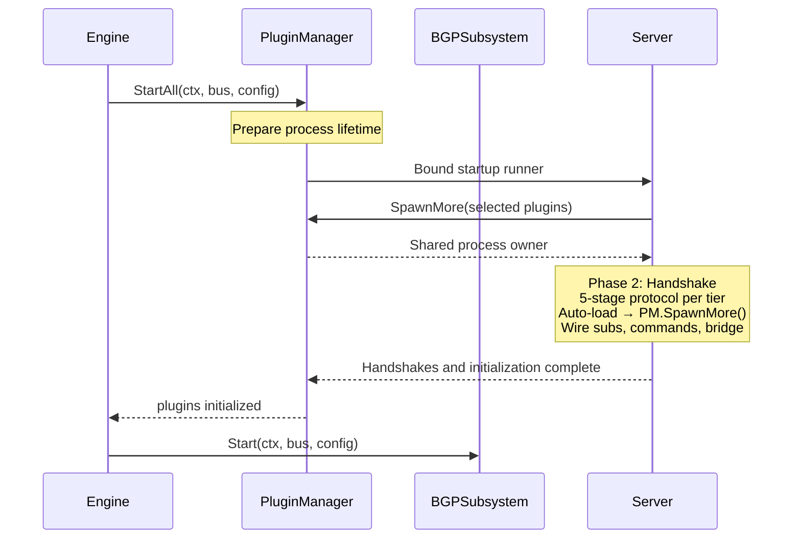
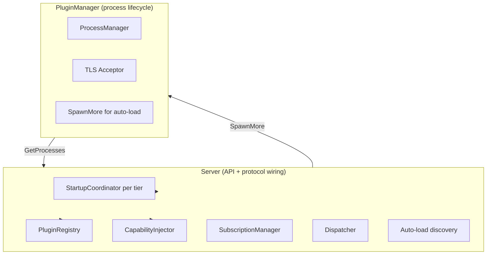
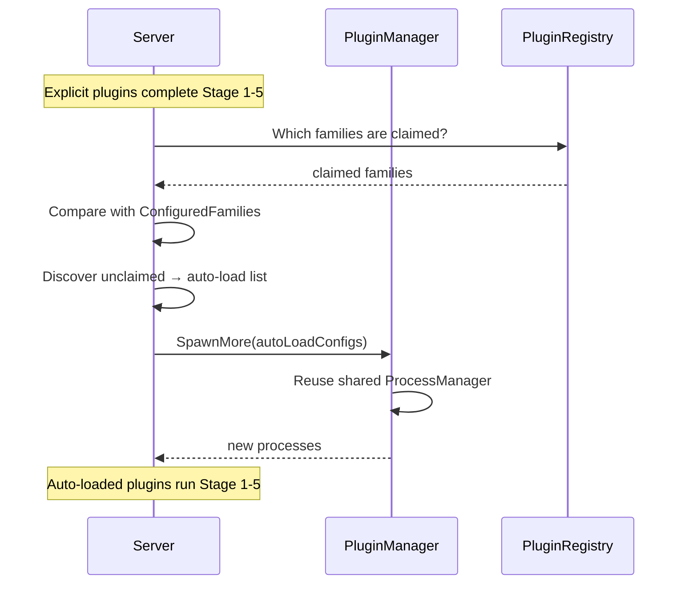

# Plugin Startup and Subsystem Readiness

The plugin manager owns process lifetime; the plugin server owns discovery and
the protocol handshake. The hub connects them before starting the engine, so
the engine joins complete plugin initialization before starting its subsystems.

## Problem

Preparing process management alone does not make plugin resources usable. A
subsystem may need interfaces or another resource that a plugin creates. Its
Start must follow that plugin's configuration and declared initialization.

## Solution: Two-Phase Startup

The server is constructed in the hub before Engine.Start. The hub binds
Manager.SetStartupRunner to start that server and join WaitForStartupComplete.
StartAll first prepares the shared manager context, then invokes this runner
without holding the manager lock, allowing the server to call SpawnMore.

### Process Lifetime (PluginManager owns)

PluginManager.StartAll prepares the context and shared references, then joins
its bound startup runner. SpawnMore creates the single ProcessManager on its
first call and reuses it thereafter, supplies the TLS acceptor, and starts the
selected processes. The hub MUST bind its runner before Engine.Start.

Outside terminal server teardown, StopAll cancels an in-flight runner and joins
its actual return. A failed start
stops its process resources before permitting a retry. A runner receives the
manager's context and MUST honor cancellation; it must never wait for StopAll
from inside its own startup call.

For whole-daemon stop, the internal `ProcessSpawner` interface requires
`SealProcessAdmission() func()`. The spawner MUST be bound before server startup.
The server seals admission, then reads the stable owner through the existing
`GetProcessManager` method, including when a first phase is still preparing to
publish its owner. Both methods use the short admission lock, so connect-back
cannot delay the seal or owner capture. The server selects the reverse
selected startup graph; the process manager still owns process cleanup and its
single deadline. The outer manager cancels its parent only after that cleanup.
A failed startup cannot cancel providers behind the terminal owner's back.
<!-- source: internal/component/plugin/types.go -- ProcessSpawner -->
<!-- source: internal/component/plugin/manager/shutdown.go -- SealProcessAdmission, prepareProcessManager -->
<!-- source: internal/component/plugin/manager/manager.go -- GetProcessManager -->
<!-- source: internal/component/plugin/server/shutdown.go -- sealProcessAdmission -->
<!-- source: internal/component/plugin/manager/startup_runner.go -- SetStartupRunner, startAll -->
<!-- source: internal/component/plugin/manager/manager.go -- SpawnMore, StopAll -->

PluginManager does NOT:
- Run the 5-stage protocol (needs Server)
- Discover auto-load plugins (needs Stage 1 registration results)
- Wire subscriptions, commands, or DirectBridge

### Phase 2: Protocol Handshake (Server owns)

Server receives spawned processes from PluginManager and runs the handshake:
- Computes dependency tiers
- Runs 5-stage protocol per tier (registration → config → capabilities → registry → ready)
- Resolves configured and explicit plugin selections, then discovers later auto-load sets
- Calls PluginManager.SpawnMore() for auto-loaded plugins
- Runs 5-stage for auto-loaded plugins
- Starts async RPC handlers after all tiers
- Signals reactor ready

For a plugin declaring started-handler, Stage 5 also joins the ordinary
runtime-ready callback after ready is acknowledged. The callback cannot run
until OnStarted succeeds. Existing dependency tiers therefore order initialized
resources: an interface plugin ordered after a data-plane owner configures its
interfaces only after that owner's initialization receipt.
<!-- source: internal/component/plugin/server/startup_driver.go -- runStartupHandshake -->

Server does NOT:
- Create ProcessManager (PluginManager owns it)
- Fork processes (PluginManager does it)
- Join processes itself (the process manager owns cleanup and the deadline)

## Component Ownership

## Interface Changes

PluginManager gains process-management methods:

| Method | Purpose |
|--------|---------|
| `SetStartupRunner(fn)` | Bind complete protocol startup before StartAll |
| `StartAll(ctx, bus, config)` | Prepare process management and join the bound runner |
| `SpawnMore(configs) error` | Spawn additional plugins (auto-load) |
| `GetProcessManager()` | Server reads the shared process owner |
| `StopAll(ctx)` | Cancel startup, stop process resources and join the runner |

Server gains a handshake entry point:

| Method | Purpose |
|--------|---------|
| `StartWithContext(ctx)` | Begin discovery and the tiered protocol |
| `WaitForStartupComplete(ctx)` | Join the actual handshake and initialization outcome |

## Auto-Load Flow

Auto-load happens during Phase 2 because it depends on Stage 1 registration results:

## What Moves vs What Stays

| Component | Before | After |
|-----------|--------|-------|
| ProcessManager creation | Server.runPluginPhase | PluginManager.SpawnMore, first call |
| TLS acceptor setup | Server.runPluginPhase | PluginManager.SpawnMore |
| Process fork/goroutine | Server.runPluginPhase | PluginManager.SpawnMore |
| Tier computation | Server.runPluginPhase | Server.runPluginPhase |
| 5-stage protocol | Server.handleProcessStartupRPC | shared runStartupHandshake |
| Auto-load discovery | Server.runPluginStartup | Server.runPluginStartup |
| Auto-load spawning | Server.runPluginPhase | PluginManager.SpawnMore |
| Subscription wiring | Server | Server (unchanged) |
| Command registration | Server | Server (unchanged) |
| DirectBridge wiring | Server | Server (unchanged) |
| Process stop/cleanup | Server.cleanup | ProcessManager, with graph order selected by Server.cleanup |

## Stage 1 Registration: Config Transaction Fields

<!-- source: pkg/plugin/rpc/types.go -- DeclareRegistrationInput -->

Stage 1 (`declare-registration`) includes fields for the config transaction protocol:

| Field | Type | Purpose |
|-------|------|---------|
| `wants-config` | `[]string` | Config roots the plugin owns or watches (existing) |
| `verify-budget` | `int` | Estimated verify time in seconds (0 = trivial) |
| `apply-budget` | `int` | Estimated apply time in seconds (0 = trivial) |

Budgets are capped at 600 seconds. The engine uses the maximum across all participants
as the phase deadline. Plugins update their budgets in verify/apply ack events; the
engine stores updated values for the next transaction.

See `docs/architecture/config/transaction-protocol.md` for the full protocol.
