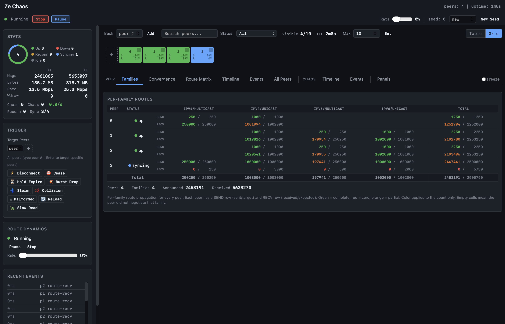

# Chaos Testing

Ze includes a chaos testing mode that injects faults during operation to verify the daemon handles failures correctly. This is useful for validating configuration changes, testing plugin resilience, and finding edge cases before production.

## Quick Start

```bash
# Run the native chaos unit suites.
./le chaos selftest unit
./le chaos selftest cli-unit

# Run the chaos orchestrator. le builds itself; no separate binary is needed.
./le chaos run --seed 42 --peers 4 --duration 30s
```

`./le chaos run <options>` runs the chaos orchestrator. A help word after `./le chaos run` reaches the orchestrator, which
prints its own option list.
<!-- source: internal/le/chaos/run/run.go -- Answer -->

## Flags

| Flag | Description | Default |
|------|-------------|---------|
| `--chaos-seed <N>` | PRNG seed for reproducible faults. `-1` = time-based. `0` = disabled. | 0 (off) |
| `--chaos-rate <f>` | Probability of fault per operation (0.0 to 1.0) | 0.1 |
<!-- source: cmd/ze/ze_core_dispatch.go -- chaosSeed, chaosRate global flags -->
<!-- source: internal/component/bgp/config/loader.go -- injectChaos -->
<!-- source: internal/component/bgp/config/loader_create.go -- chaosRateFromEnv, ze.bgp.chaos.seed/rate -->

## Chaos Tool

The chaos tool, `./le chaos run`, is a chaos simulator that runs multiple BGP peers against a ze route server, validates route propagation, and injects faults.



The web dashboard shows real-time peer status, per-family route propagation, convergence progress, and fault triggers. Color coding indicates propagation state: green = complete, orange = partial, red = zero.

```bash
# Fork mode (default): le chaos run starts ze as a child process
./le chaos run --seed 42 --peers 8 --duration 60s

# Specify ze binary path
./le chaos run --binary ./bin/ze --seed 42 --peers 8 --duration 60s
```

Fork mode runs the ze daemon that `--binary` names, else the `ze` on PATH. It
refuses when neither names a program, and it refuses a path that is the running
`le` itself, because `le` is not a ze daemon.
<!-- source: internal/chaos/orchestrator/fork.go -- resolveZeDaemon -->

```bash
# Pipeline mode: config on stdout, diagnostics on stderr
./le chaos run --pipe --seed 42 --peers 8 --duration 60s | ./bin/ze -

# Write config to file
./le chaos run --config-out chaos.conf --seed 42 --peers 8
ze start chaos.conf

# In-process mode: mock network + virtual clock (fully deterministic)
./le chaos run --in-process --seed 42 --duration 30s

# In-process with chaos and route dynamics
./le chaos run --in-process --seed 42 --duration 60s --chaos-rate 0.1 --route-rate 0.05

# Multi-family
./le chaos run --families ipv4/unicast,ipv6/unicast --chaos-rate 0.2 --pipe | ./bin/ze -
```

### Session Start

A simulated peer starts its session as a BGP speaker does. When the daemon
refuses the connection, or closes it before sending any byte of its OPEN, the
peer counts a failed connection attempt and connects again: five connections
at most, after waits of 50, 100, 200 and 400 ms. Each retry is a `reconnecting`
event that carries the cause, so the event log, the dashboard and the
reconnection count show it. After the fifth attempt the peer fails with one
error naming the address, the number of attempts and the last cause. Every
other failure ends the peer's run at once and is never retried: a handshake
read that waits 10 seconds, a close after the daemon's OPEN began to arrive, a
NOTIFICATION. A caller that hands the simulator a connection it opened itself
gets the retry only when it also gives the address to dial. In a run with
chaos enabled the orchestrator then starts the peer again after 2 seconds, as
it does after any disconnect.
<!-- source: internal/chaos/peer/simulator_connect.go -- establishSession -->
<!-- source: internal/chaos/orchestrator/scheduler.go -- runPeerLoop -->

### Multi-Daemon Testing (FRR, BIRD)

./le chaos run can generate configs for and fork FRR (bgpd) or BIRD, so the same
chaos scenario runs against different BGP implementations.

```bash
# Generate FRR config to inspect
./le chaos run --config-only --application frr --seed 42 --peers 4

# Generate BIRD config to inspect
./le chaos run --config-only --application bird --seed 42 --peers 4

# Fork FRR bgpd (auto-discovers bgpd in PATH)
./le chaos run --application frr --seed 42 --peers 4 --duration 60s

# Fork BIRD with explicit binary path
./le chaos run --application bird --binary /usr/sbin/bird --seed 42 --peers 4 --duration 60s

# Write config to file, start daemon manually
./le chaos run --config-only --application frr --config-out chaos-frr.conf
bgpd -f chaos-frr.conf -p 1850 -l 127.0.0.1 -P 0 -n -Z -S
```

FRR and BIRD use a single BGP port with peers identified by source IP address
(127.0.0.x), unlike Ze's per-peer port model. On Linux, the 127.0.0.0/8 range
is routed to loopback by default. On macOS, loopback aliases are needed:

```bash
# macOS only: create loopback aliases for each peer
for i in $(seq 2 $((peers+1))); do
  sudo ifconfig lo0 alias 127.0.0.$i
done
```

`./le setup install` adds 127.0.0.2 through 127.0.0.6 (and the IPv6 address the
functional suite binds), so the loop above is needed only for a run with more
than five peers. `./le setup check` reports which addresses are missing.
Neither route survives a reboot; re-run `./le setup install` after one.

<!-- source: internal/le/setup/actions.go -- Answer -->

#### Running via Docker

When FRR or BIRD is not installed locally, use Docker. The `--network host`
flag shares the host network so `le chaos run` simulators can connect directly
(Linux only; macOS Docker Desktop does not support host networking).

```bash
# Start FRR in Docker, le chaos run on the host
./le chaos run --config-only --application frr --seed 42 --peers 4 \
  --config-out chaos-frr.conf
docker run --rm --network host \
  -v ./chaos-frr.conf:/etc/frr/bgpd.conf:ro \
  quay.io/frrouting/frr:10.7.1 \
  /usr/lib/frr/bgpd -f /etc/frr/bgpd.conf -p 1850 -l 127.0.0.1 -P 0 -n -Z -S

# In another terminal: run le chaos run against the FRR instance
./le chaos run --application frr --seed 42 --peers 4 --duration 60s \
  --config-out /dev/null

# Same pattern for BIRD
./le chaos run --config-only --application bird --seed 42 --peers 4 \
  --config-out chaos-bird.conf
docker run --rm --network host \
  -v ./chaos-bird.conf:/etc/bird.conf:ro \
  --entrypoint bird bird-interop:latest \
  -f -c /etc/bird.conf -s /tmp/bird.ctl
```

#### Config Validation (no live session)

Validate generated configs without running a full session:

```bash
# FRR: -C flag checks config and exits
./le chaos run --config-only --application frr > frr.conf
docker run --rm -v ./frr.conf:/etc/frr/bgpd.conf:ro \
  quay.io/frrouting/frr:10.7.1 \
  /usr/lib/frr/bgpd -C -f /etc/frr/bgpd.conf -n -Z -S -p 0 -P 0

# BIRD: -p flag parses config and exits
./le chaos run --config-only --application bird > bird.conf
docker run --rm -v ./bird.conf:/etc/bird.conf:ro \
  --entrypoint sh bird-interop:latest \
  -c 'bird -p -c /etc/bird.conf'
```
<!-- source: internal/chaos/orchestrator/cli.go -- --application, --binary flags; internal/chaos/scenario/config_frr.go, config_bird.go -->

### Event Logging and Replay

```bash
# Record events
./le chaos run --pipe --event-log run.ndjson --seed 42 | ./bin/ze -

# Replay a recorded failure
./le chaos run --replay run.ndjson

# Shrink to minimal reproduction
./le chaos run --shrink run.ndjson
```
<!-- source: internal/chaos/orchestrator/subcommand.go -- event logging, replay, shrink modes -->

### Property Validation

```bash
./le chaos run --pipe --properties all --convergence-deadline 5s | ./bin/ze -
./le chaos run --properties list    # Show available properties
```

Properties validated:
- **Convergence:** All routes reach all peers despite faults
- **State consistency:** RIB matches peer state after recovery
- **No data loss:** Updates eventually delivered
- **Graceful degradation:** Sessions restart on critical faults

### Simulated Network Topology

A chaos run announces routes generated from the seed: every peer sends its own
prefixes, each with the peer's router id as next hop. That exercises
propagation. It does not look like a network, where a border router rewrites
the next hop to itself and every router of the AS reports the exit it chose.

The scenario package can also build one network and let each simulated peer
announce exactly what that network's routers and neighbours would send to a
route collector.

| Step | What it does |
|------|--------------|
| `scenario.GenerateTopology` | Builds the routers of one AS, a route reflector with its clients, the border routers and their external neighbours from a seed, and computes each speaker's announcements |
| `scenario.GenerateFromTopology` | Gives one peer profile per speaker, each carrying its announcements as a route set |
| `scenario.GenerateConfig` with `Collector` | Writes the Ze config for those peers: `bgp-rib` inside the daemon, no route server |
| The peer simulator | Holds one real BGP session per speaker and announces the route set, each route with its own next hop and AS path, then End-of-RIB |

The test fixture `plugin/lg-simulated-network` runs five routers and six
external neighbours this way and compares the looking glass with the model. It
needs no loopback alias: each speaker reaches Ze on a listen port of its own,
and Ze knows the session by the address its config gives the peer. A second
fixture, `plugin/lg-simulated-unchanged-next-hop`, runs a small network written
by hand in which one border router keeps the next hop its neighbour sent.

`./le chaos run` does not take a topology: it starts from `--seed` and
`--peers`. The design is in
[the chaos architecture page](https://github.com/ze-software/ze/blob/main/docs/architecture/chaos-web-dashboard.md#simulated-network-topology).
<!-- source: internal/chaos/scenario/generator.go -- GenerateFromTopology -->
<!-- source: internal/chaos/peer/sender.go -- BuildAnnouncement -->
<!-- source: internal/test/fixture/lg_simulated_network.go -- lgSimulatedNetworkFixture -->

## Fault Types

| Category | Examples |
|----------|---------|
| Network I/O | Connection failures, partial writes, read timeouts |
| Wire parsing | Malformed messages, truncated packets |
| FSM | State machine violations, invalid transitions |
| Route processing | Dropped updates, corrupted NLRI |
| Event delivery | Lost messages, out-of-order events |

## Deterministic Replay

With a fixed seed, chaos testing is fully reproducible:

```bash
# These two runs produce identical fault sequences
ze --chaos-seed 42 --chaos-rate 0.1 config.conf
ze --chaos-seed 42 --chaos-rate 0.1 config.conf
```

Seed `0` disables chaos entirely (zero overhead). Seed `-1` uses the current time (non-reproducible).
<!-- source: cmd/ze/main.go -- chaosSeed handling -->

## Native Commands

| Command | Description |
|---------|-------------|
| `./le chaos selftest unit` | Run chaos simulator unit tests |
| `./le chaos selftest cli-unit` | Run the orchestrator's command-line tests through `le chaos run` |
| `./le chaos run <options>` | Run the chaos orchestrator |

## When to Use

- **Before deployment:** Validate your config handles peer failures
- **CI pipeline:** Catch race conditions and edge cases
- **Debugging:** Reproduce intermittent failures with a fixed seed
- **Benchmarking:** Measure convergence time under fault conditions
<!-- source: internal/chaos/orchestrator/cli.go -- the chaos tool; test/ -- chaos functional tests -->
