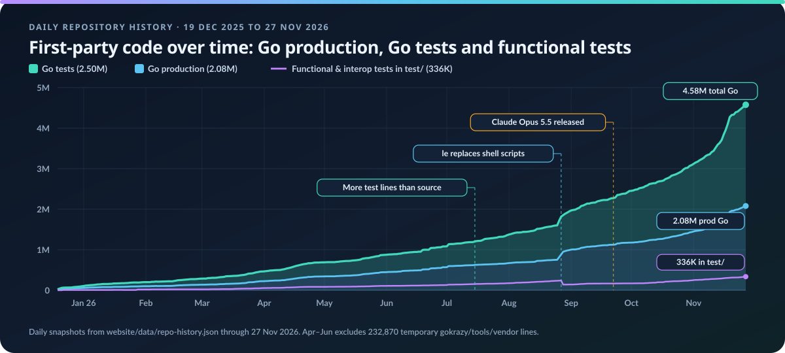
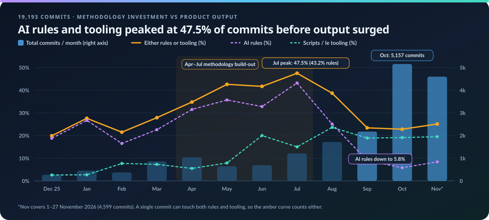
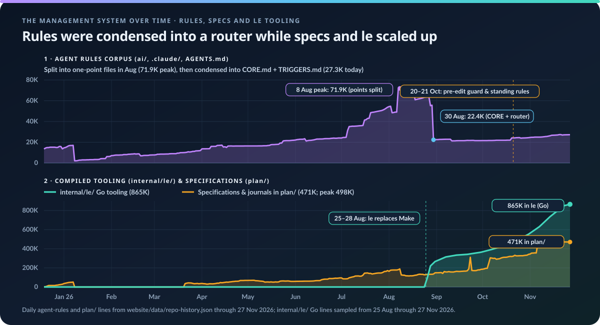

Ze's first commit was recorded on 19 December 2025. Over the eleven months since then, the repository has grown from an early BGP prototype into a multi-protocol network operating system, and the pace of development has risen sharply since the summer.

Stronger AI models explain part of that change, while the Git history points to a second cause: months spent building repository rules and development tooling instead of shipping features reduced how much supervision each session needed, which let me run multiple AIs in parallel and put far more tokens to work at once.

*This article was drafted with Gemini. The experience, architecture and conclusions are mine. Gemini helped extract the repository history figures, draw the charts and draft the text.*

## What the growth curve shows

Lines of code are a rough proxy for engineering progress. They include comments, blank lines and development tooling, they swell during refactors, and a larger file says nothing on its own about whether the router behaves as an RFC requires. Code has to be judged by the behaviour we can establish against the protocol, which I discussed in [AI slop is human slop](../ai-slop-is-the-wrong-test/) and [The proof is the expensive part](../the-proof-is-the-expensive-part/).

Tracked the same way across eleven months of one repository, the shape of the curve on our [Activity](../../project/activity/) page still shows a clear change in gear. Through winter, Ze grew by roughly 100,000 lines of first-party Go a month, then settled around 200,000 a month through spring. From August onwards the slope steepened past half a million lines a month, reaching nearly 1.5 million in November alone and taking the codebase past 4.5 million lines of first-party Go.

*Daily first-party Go production lines, Go test lines and functional tests under `test/` from 19 December 2025 to 27 November 2026, excluding 232,870 temporary `gokrazy/tools/vendor` lines in April and May.*

That expansion went heavily into proving the code rather than piling up unchecked features. Go test code overtook Go production code in July and kept pulling ahead, sitting at roughly 2.5 million test lines against 2.1 million production lines by late November, alongside more than 300,000 lines of functional and interoperability scenarios.

## Models crossed a threshold for unsupervised work

The first cause of that acceleration is the models themselves. When I started Ze in December 2025, Claude Opus 4.5 was the first model that made agentic engineering workable, because an agent could take a pre-agreed specification through to tested Go code while I supervised the session closely. Even so, those early runs struggled to stick to project conventions, verify their assumptions and finish the edge cases, so I had to break tasks into small pieces and inspect each turn carefully.

Progress across the year was uneven. On Claude's Opus line, I liked 4.5, was okay with 4.6, disliked 4.7 and hated 4.8; 5.0 brought a large shift, and with 5.5 I was back to liking the model again. Having the best model does not always mean it is nice to use.

Over 2026, newer generations of models, including Claude Opus 5.5 (released by Anthropic on 22 September 2026), OpenAI's Sol and Astra line, and Gemini Neon, changed how reliably a session handles real coding work. Part of that change is that sessions stay on track without drifting; the bigger shift is that the models keep up with a multi-package codebase and make the right call when a problem turns up while developing code. They follow multi-phase specifications without losing earlier constraints, so I spend far less time arguing with a session over basic discipline than I did in January. Opus 5.5 was also the first model that correctly and consistently caught problems in existing code while implementing a new specification. Whenever it reported an existing defect outside its assigned task, I had it write a specification for that issue as well, so the number of specifications grew directly from those findings.

Because each session needed less babysitting, I could run more work concurrently, and the recent jumps reflect both stronger models and more token capacity. After Opus 5.5 arrived in late September and proved far more capable than earlier releases, I moved my OpenAI subscription to a larger plan for October, and on 22 November I added Gemini Neon alongside it. I only scaled up token capacity like that because checking each session's output was no longer the bottleneck, and because I wanted to get Ze ready for its first anniversary on 19 December. Earlier in the year, supervising one agent closely took most of my attention; recently, stronger models and tighter repository rules let me delegate much more broadly and run several sessions in parallel.

Once we brought in Gemini Neon and fixed how the test workflow ran with it, I could also get far more testing done. Gemini Neon kept working through long runs of RFC test gaps where Opus would often stop early or lose focus. Because I can now put each model on the work where it holds up best, I have been able to implement far more test coverage, and Gemini Neon has become my new favourite model.

Better models alone still cannot explain the whole jump. A more capable model arrives in a fresh session with no memory of why Ze registers plugins instead of switching on names, why external processes cross a TLS bus, or which scope questions I have already settled. Without rules and checks inside the repository, a faster unsupervised agent just produces architectural mistakes faster.

## Months spent on the methodology before the payoff

The Git history shows where the other half of the acceleration came from. When we group Ze's 19,000 commits by whether they touched AI rules or development tooling, the timeline reveals a long investment phase before output took off.

*Monthly commits across the repository (bars, right axis) alongside the share touching AI rules, development tooling or either (lines, left axis), showing the April to July build-out and the autumn surge in commits.*

Between April and July, a third to nearly half of every commit went into building and repairing the methodology itself, peaking at 47.5 per cent in July (with AI rules alone accounting for more than 43 per cent). At the time, it felt slow to spend almost half the commit stream on process instead of routing features, and monthly code growth stayed flat. Yet we turned each recurring agent mistake during those months into a tighter rule, a clearer index or a mechanical check, as I described in [The repository is half the AI harness](../the-repository-is-the-ai-harness/) and [AI coding has not had its Rails moment](../ai-coding-has-not-had-its-rails-moment/).

Once those pieces settled in late summer, the ratio inverted. Commits touching AI rules fell below nine per cent from September onwards, while monthly commit volume climbed past 5,000 in October and kept pace through November.

## Turning scattered scripts into `le` and structured rules

By early August, the rule files had grown so large that loading everything into every session buried the guidance that mattered for the task at hand. We condensed the always-on rules into [`CORE.md`](https://github.com/ze-software/ze/blob/main/ai/rules/CORE.md) and routed specialised rules through a one-line-per-rule [`TRIGGERS.md`](https://github.com/ze-software/ze/blob/main/ai/rules/TRIGGERS.md) index, which cut the loaded rules by more than half while keeping every rule reachable when a task matches its trigger.

Later that same month, we replaced a growing pile of shell scripts, Python checks and `Makefile` targets with `le`, compiled in Go under [`internal/le/`](https://github.com/ze-software/ze/tree/main/internal/le) as a development personality of `cmd/ze` that never ships in the `ze` binary. Once the tooling lived in one compiled binary, helpers stopped drifting between macOS and Linux and parallel sessions became safe in a single shared checkout: `./le commit create` stages only the files a session names, `./le ai hooks` enforces pre-write and pre-command guards, `./le job run` schedules heavy builds and tests, and `./le rfc record` verifies that RFC tests fail when the producing code is broken. Unlike the AI rules, `le` keeps growing alongside Ze; it now makes up nearly a fifth of our first-party Go code and still takes about a fifth of monthly commits as test suites, interoperability labs and chaos runners expand.

In late October, two more additions removed the last routine interruptions for unsupervised work. [Subsystem doors](https://github.com/ze-software/ze/blob/main/ai/doors/README.md) (`ai/doors/`) give each area of Ze a short boundary document stating its external contracts and traps, backed by a write hook that refuses Go or specification edits until the session has read it. Alongside them, [`ai/META-DECISIONS.md`](https://github.com/ze-software/ze/blob/main/ai/META-DECISIONS.md) loads my standing rulings on scope, testing and workflow at the start of every session, so agents stop pausing to re-ask settled questions or ask permission to defer difficult work.

*Daily size of Ze's management system across the same timeline: `agent-rules` peaking on 8 August before condensing into `CORE.md` and `TRIGGERS.md`, alongside compiled Go tooling in `internal/le/` and specifications under `plan/`.*

## What high-level delegation looks like now

Looking back, Ze was designed in 2025 for the AI created one year later. As many people were already saying back then, the worst AI you will ever use is the AI you are using today. In the same way, it was possible to imagine video streaming on the Internet when dial-up was created, long before the links could carry it well. When I set up Ze's modular plugin architecture and specification-driven workflow in December 2025, I was building for agents that could work across subsystems with far less supervision than the models of the time could sustain.

Earlier in the year, a task still had to be spelled out step by step because an agent could drift across plugin boundaries, weaken a failing test to turn CI green, or stop to ask for a ruling I had already made weeks earlier. With stronger models now working inside that [development framework](../../project/ai-development/), I can hand over a high-level objective and let agents run most of the implementation and verification loop: closing a whole class of dropped-error defects across subsystems, driving fault-checked RFC compliance across a protocol, or building a deterministic fault injector such as [Le Chaos](../le-chaos/) together with its web dashboard and MCP server. Several sessions work through separate specifications in the same checkout in parallel while the doors state the boundaries before the first edit, independent agents review the diff and judge any test change, and `le` handles commits, hooks and job scheduling underneath them.

That investment still carries an ongoing maintenance bill. `internal/le/` accounts for nearly a fifth of commits, hooks still trigger false alarms that have to be repaired, and rules written for earlier models have to be pruned once newer models follow the convention on their own. The difference after eleven months is where my time goes: far less of it is spent repeating the same instructions or guiding a session through routine plumbing, and far more goes into deciding Ze's architecture and what to build next.

*Originally written: 27 November 2026. The history of this article is available in the [project's Git repository](https://github.com/ze-software/ze/commits/main/website/blog/posts/a-year-of-building-ze-with-ai.md).*
