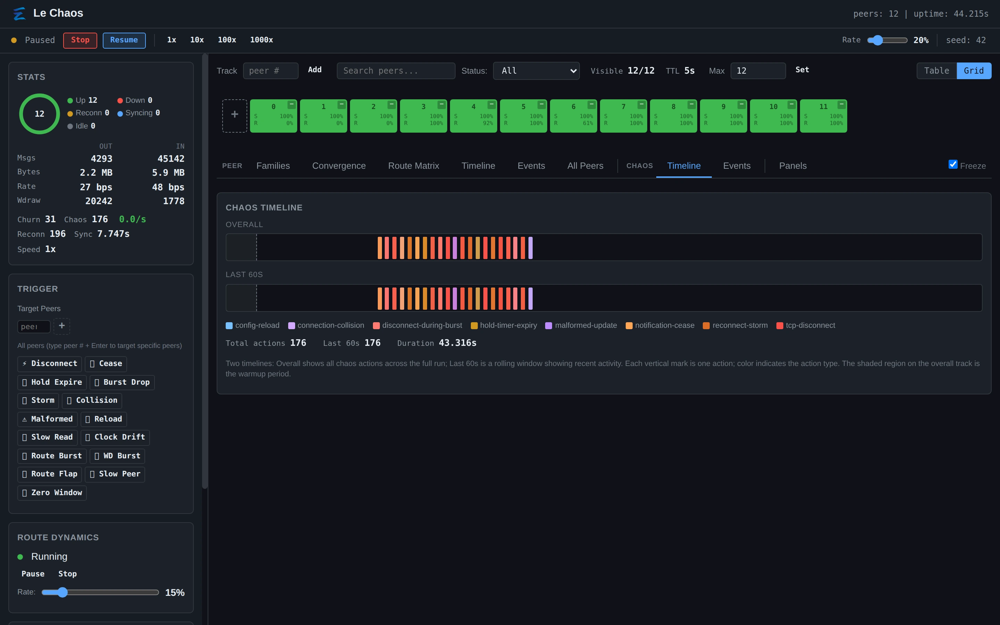
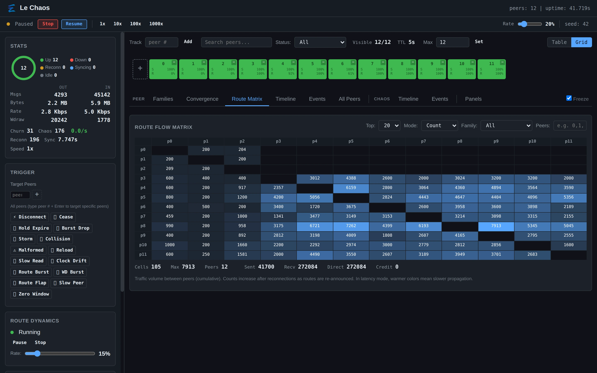

A BGP daemon can pass its unit tests, establish sessions with FRR and BIRD in a lab, and still misbehave the first time a real peer drops mid-burst or stops reading its socket. The faults that cause network outages rarely happen on quiet sessions one at a time.

To expose those failures before release, we needed a way to break BGP sessions under load on purpose, watch how every peer converges, and turn any failure into a repeatable trace from a single seed.

*This article was drafted with Gemini. The architecture, design decisions and conclusions are mine. Models helped with implementation, testing and drafting the text.*

## Why scripted interop is only half the test

In [The proof is the expensive part](../the-proof-is-the-expensive-part/), I wrote about connecting individual RFC obligations to tests and interoperability labs. Those checks establish that Ze sends the right bytes on the wire and strips attributes when an RFC forbids them. They are written around known scenarios where each peer follows a script.

Production BGP is rarely that polite. A route server or route reflector handles dozens of concurrent sessions while peers disconnect during initial route bursts, stall under TCP backpressure, send malformed attributes, flap prefixes, or lose an underlying network interface. A defect that only surfaces when a reconnect overlaps with a bulk withdrawal will survive a tidy lab run untouched.

Throwing random failures at a daemon is easy, and largely useless if you cannot repeat what happened. A bug that appears once after ten minutes of churn costs hours to diagnose unless the exact peer topology, route set and fault sequence can be reproduced from a single input.

## One seed across real sockets, virtual time and three BGP daemons

Le Chaos runs through `./le chaos run` and builds the entire scenario from one `--seed`. From that seed, the generator produces a mix of eBGP and iBGP peer profiles, generates the target daemon configuration, and opens real BGP sessions to exercise route reflection and route-server forwarding across multiple address families.

```bash
# Run twelve simulated peers against a forked Ze daemon with live dashboard and properties
./le chaos run --seed 42 --peers 12 --routes 200 --chaos-rate 0.15 --properties all --web :8000
```

Three execution modes serve different stages of debugging. By default, the orchestrator forks `ze` as a child process over real sockets, and `--pipe` writes the generated configuration to standard output so it can be fed straight into `ze -`. Both exercise the full binary, operating system sockets and signal handling.

Passing `--in-process` connects the simulated peers directly to Ze's BGP reactor over in-memory `net.Pipe()` connections and replaces wall-clock timers with a virtual clock starting at a fixed epoch (`2025-01-01T00:00:00Z`). Simulated time can run at `1x`, `10x`, `100x` or `1000x`, so a session hold-timer expiry or a multi-minute churn run completes in seconds without slowing down on real sleeps.

Because the scenario generator also writes configurations for FRR (`--application frr`) and BIRD (`--application bird`), the same seeded chaos run can be pointed at another BGP implementation. When Ze behaves differently under a fault, running the same seed against FRR or BIRD shows how established daemons react to the same sequence. The orchestrator can also write standard BGP4MP MRT dumps (`--mrt-file`) for inspection with `bgpdump` or `./le mrt`, and its scenario package includes a standalone topology model used to test Ze's [Looking Glass](../../labs/looking-glass-graph/) against computed multi-router route sets.

## Seventeen faults, from BGP frames to Linux netlink

The chaos scheduler supports seventeen fault types spanning TCP transport, BGP protocol handling, route churn and the Linux kernel. The default automatic set covers abrupt TCP disconnects, clean NOTIFICATION Cease teardowns, hold-timer expiry by silencing keepalives, disconnects mid-burst, reconnect storms, RFC 4271 connection collisions, RFC 7606 malformed UPDATEs, SIGHUP configuration reloads and slow readers that push TCP backpressure onto Ze's write path.

Opt-in parameterised actions add finer disturbances through `--chaos-actions`, the web dashboard or MCP: keepalive clock drift, route bursts, withdrawal bursts, cyclic route flaps, artificially delayed peers and TCP zero-window stalls. Each action accepts explicit parameters such as route counts, cycle counts, intervals and durations.

Two Linux-only actions go beneath the socket layer. `iface-link-flap` and `iface-addr-remove` manipulate a real network interface via netlink inside an isolated Linux network namespace, cycling link carrier state or removing and restoring the peering IP address on a veth pair.

```bash
# Inside a Linux network namespace with veth0 (10.242.0.1/24) <-> veth1 (10.242.0.2/24)
./le chaos run \
  --local-addr 10.242.0.1 \
  --peer-local-addr 10.242.0.2 \
  --chaos-actions iface-link-flap,iface-addr-remove \
  --fault-iface veth1 \
  --fault-addr 10.242.0.2/24 \
  --fault-iface-cycles 1 \
  --fault-iface-interval 500ms \
  --duration 60s
```

These interface faults stay deliberate no-ops on plain loopback runs and are excluded from the web dashboard's manual trigger list so a browser click can never touch a host interface. Inside a namespace test, configured defaults propagate to both automatic scheduler ticks and manual triggers, proving that Ze tears down and recovers a live BGP session when the link or local address disappears underneath it.



*The Chaos Timeline plots every injected fault across the full run and the rolling sixty-second window, colour-coded by action type after the shaded warmup period.*

## Watching and steering a live run in the browser

A terminal log is fine for CI, while diagnosing why one peer stopped converging during a burst is much faster when you can see the whole network at once. Passing `--web :8000` attaches a live web dashboard built with HTMX and Server-Sent Events directly to the orchestrator's `report.Consumer` fan-out. Every stylesheet, template and script is embedded in the binary via `go:embed`, so the dashboard works in air-gapped labs with zero external assets.

At the top, the control strip displays the active seed alongside live Pause, Resume and Stop buttons, a chaos-rate slider, a new-seed restart input and, in `--in-process` mode, virtual-clock speed buttons (`1x`, `10x`, `100x`, `1000x`). On the left sit the live status donut, message and bit-rate counters, property badges, route dynamics controls and the manual trigger panel, where an operator can pick specific peer indices and inject an action on demand.

The main pane switches between a compact colour-coded peer grid and a sortable active-set table. Because a large peer run cannot usefully render every row at once, the table maintains a bounded active set: peers auto-promote on disconnects, errors or chaos events, stay pinned when an operator locks them, and decay out under an adaptive TTL as pressure rises. Clicking a peer opens its detail pane with route summaries, state history and recent events.

Below the peers, tabs switch between per-family route propagation counts (green for complete, orange for partial, red for zero), the convergence latency histogram and trend, a peer-to-peer route flow heatmap, peer state timelines, chaos timelines and a 2×2 multi-panel view (shown at the top of this page). A `Freeze` toggle pauses visualisation polling without stopping the simulation, so you can inspect a transient state or capture a screenshot.



*The Route Flow Matrix renders peer-to-peer route propagation as a heatmap, separating iBGP clients from eBGP route-server peers across all twelve simulated sessions.*

Writing end-to-end headless Chromium tests for those interactive controls (`test/web/chaos-interactive-controls.wb` and `test/web/chaos-freeze-and-stop.wb`) immediately paid for itself by uncovering three defects that Go unit tests had missed. `Dashboard.New` copied `state.Seed` into the control strip before assigning the configured seed, so the header always displayed `seed: 0`. Out-of-band SSE peer-row replacements omitted the `hx-get` detail link and pin `stopPropagation()`, breaking row clicks in Table view right after the first live update. At `10x` to `1000x` speed, rapid toast notifications stacked down from the top-right corner and covered the `Table` and `Grid` buttons until the container was anchored bottom-right with a capped height. Testing the real browser caught all three in one pass.

## Checking properties, replaying logs and shrinking failures

A daemon that stays alive while silently dropping routes has still failed. Passing `--properties all` evaluates five invariants continuously over the event stream: `route-consistency` (every eligible peer receives every announced route per family), `convergence-deadline` (deliveries and withdrawals complete within the configured deadline), `no-duplicate-routes`, `hold-timer-enforcement` and `message-ordering`. Alongside them, an always-on Watchdog consumer watches for peers stuck down, route plateaus, unexpected route regressions and convergence stalls, printing rate-limited `PROBLEM:` lines to stderr.

Every fault follows one rule: manual triggers from the web dashboard or MCP travel through the same orchestrator control path and peer event pipeline as scheduled faults, and land in the `--event-log` NDJSON file with their exact action name, parameters and sequence numbers. Nothing that affects a peer bypasses the log.

```bash
# Record a run, replay the event log, then shrink any violation to a minimal sequence
./le chaos run --seed 42 --peers 8 --properties all --event-log run.ndjson --duration 60s
./le chaos run --replay run.ndjson
./le chaos run --shrink run.ndjson
```

When a run fails a property, `--replay` re-runs the recorded header, peer reachability, deadlines and event stream through the validation engine to confirm the failure reproduces, and `--diff` compares two logs. `--shrink` then narrows a failing trace in two phases: binary search first cuts the event list down coarsely, and single-step elimination removes individual events together with their causal dependents until only the smallest subsequence that still violates the property remains. Reducing a long failing log to a handful of events turns an intermittent fault into something an engineer can trace directly in the BGP engine.

## Driving chaos from an AI assistant through MCP

Watching a dashboard is helpful when a person is debugging; during Ze development, coding agents investigate many of these failures themselves. Passing `--mcp :8001` alongside `--web` starts a JSON-RPC 2.0 server over Ze's shared Streamable HTTP MCP layer, exposing six tools (`chaos_status`, `chaos_problems`, `chaos_peers`, `chaos_scenario`, `chaos_control` and `chaos_execute`). Adding `--ze-mcp 9718` exposes the target Ze daemon's own MCP server at the same time, so an agent can inspect both the simulator and the router under test.

```bash
./le chaos run --in-process --web :8000 --mcp :8001 --ze-mcp 9718 --seed 42 --peers 8 --properties all
```

`chaos_control` is synchronous in both fork and `--in-process` modes and draws its allowed action list directly from `engine.AllActionNames()`. When an agent triggers a `route-flap` on peer 0 or adjusts the chaos rate, the call waits for the scheduler's verdict and returns exactly which peers were `dispatched`, `blocked` (with reasons) or `dropped`, while syncing the state back into the web dashboard so a human watching in the browser sees the same run.

An agent investigating a convergence regression can start a seeded run, poll `chaos_status` for per-family p99 latencies, read `chaos_problems` to isolate the affected peer, inject a targeted fault to reproduce the issue, inspect Ze's RIB through `--ze-mcp`, and leave behind a shrunk event log that turns into a permanent regression test. The full flag reference and MCP payloads live in the [chaos testing guide](../../guides/chaos-testing/) and the [chaos-tested peering use case](../../use-cases/chaos-tested-peering/).
