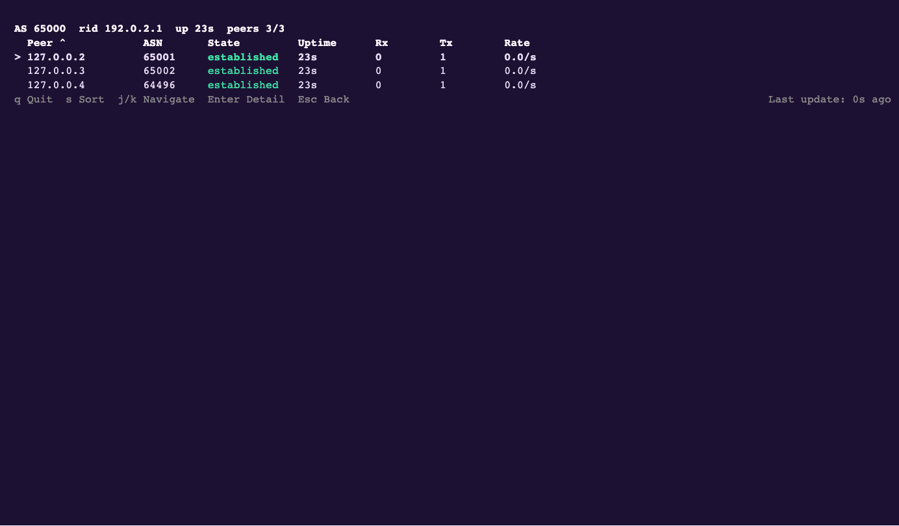

# Project overview

Follow Ze from its ExaBGP roots to a network operating system: what works today, what is changing, and what remains before the first release.

<section class="project-state" aria-labelledby="project-state-title">
    

        <h2 id="project-state-title">Where Ze stands</h2>
        
Ze brings routing protocols, Linux networking and operator tools together around one configuration. It grew from ExaBGP's programmable BGP model, with a broader job: configure the network, inspect its state, and expose the same operations to people and automation.

        
Ze is pre-release. You can explore it in a lab today; the available capabilities and their test evidence vary by feature.

    

    <a class="project-text-link" href="why-ze/">Why Ze, and where it fits →</a>
</section>

    <section class="project-latest" aria-labelledby="project-latest-title">
        
Recent work

        <h2 id="project-latest-title">Latest development</h2>
        {project_latest}
        
<a href="changes/">Browse all update reports</a>

    </section>
    <section class="project-release" aria-labelledby="project-release-title">
        
Pre-release

        <h2 id="project-release-title">Before the first release</h2>
        
The remaining work includes correctness fixes, validation of existing behavior, and release delivery. The roadmap separates these from later features and proposals.

        
Work-item counts describe the backlog. They do not measure effort or production readiness.

        

            <a href="roadmap/">Release roadmap →</a>
            <a href="../quality/">Inspect the test evidence →</a>
        

    </section>

<section class="project-demo" aria-labelledby="project-demo-title">
    

        
A recorded session on a real lab router

        <h2 id="project-demo-title">See Ze running</h2>
        
Watch an ExaBGP migration, inspect BGP peers, then configure, diagnose and repair services while the same router keeps running. The recordings include the commands and their output, with transcripts you can read at your own pace.

        

            <a class="button primary" href="../#product-terminal">Watch Ze in action ↗</a>
            <a class="project-text-link" href="../guides/quickstart/">Try the BGP quickstart →</a>
        

        
<a href="../demos/terminal/#continuous-live-configuration-showcase">Open the continuous configuration recording and transcript</a>

    

    <a class="project-demo-preview" href="../#product-terminal">
        
        Preview from Ze's published terminal recording. Open the player to watch.
    </a>
</section>

<section class="project-history" aria-labelledby="project-history-title">
    
Recorded achievements

    <h2 id="project-history-title">How we got here</h2>
    
These recent landmarks mark capabilities that arrived in Ze. The full timeline and project history explain how the system developed.

    {project_landmarks}
    

        <a href="milestones/">Explore the milestone timeline →</a>
        <a href="history/">From ExaBGP to Ze →</a>
    

</section>

<section class="project-development" aria-labelledby="project-development-title">
    

        <h2 id="project-development-title">How Ze is built</h2>
        
AI coding agents write most of Ze's code within a framework of specifications agreed before implementation, tests written before code, independent reviews and commit checks. That process is iterative: code and the checks that exercise it improve as problems are found. Checking a first version against every requirement takes time and resources, so published code can still be imperfect.

        
Most of this site's information is generated from the code. Its free text has more room for mistakes than protocol behavior defined by an RFC, so reports of unclear or incorrect information help improve it.

        <a class="project-text-link" href="ai-development/">How Ze is developed with AI →</a>
    

    <nav class="project-reading" aria-label="Project reading and activity">
        <a href="../blog/"><strong>Engineering blog</strong>Longer accounts of the design and development.</a>
        <a href="../talks/"><strong>Talks</strong>Presentations about Ze and ExaBGP.</a>
        <a href="activity/"><strong>Development activity</strong>Repository history and the scope of the code.</a>
    </nav>
</section>

<section class="project-participation" aria-labelledby="project-participation-title">
    

        <h2 id="project-participation-title">Get involved</h2>
        
Try Ze in a lab and report a failure with its configuration, trace or transcript. Documentation corrections, interoperability results, tests and focused code changes all help the project move forward.

    

    <a class="button" href="../contribute/">Contribute to Ze →</a>
</section>

